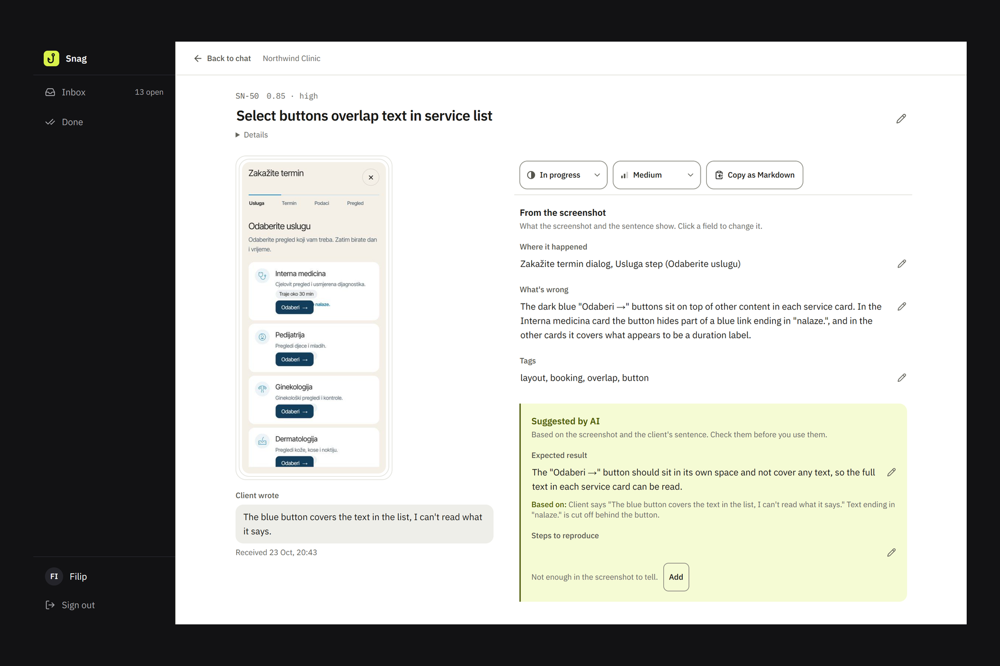
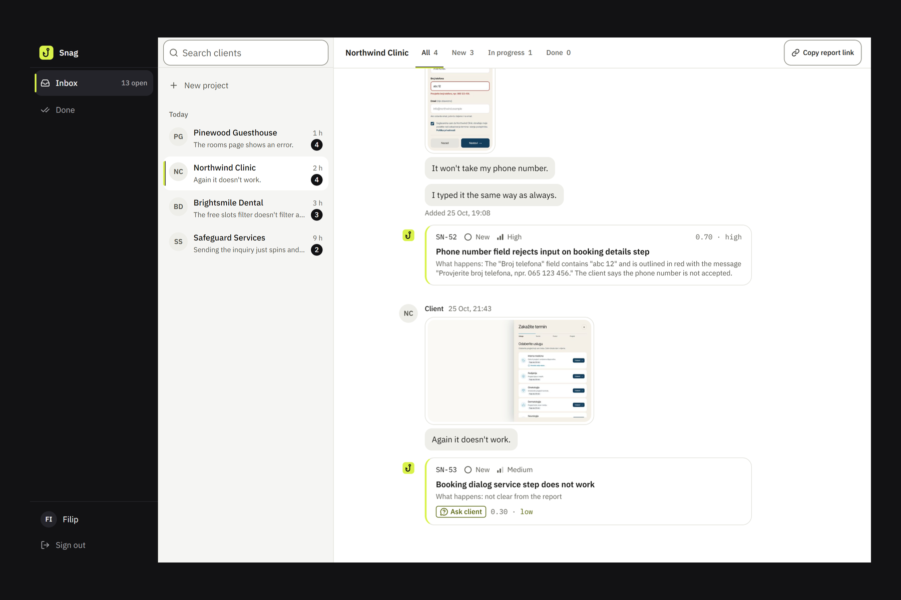
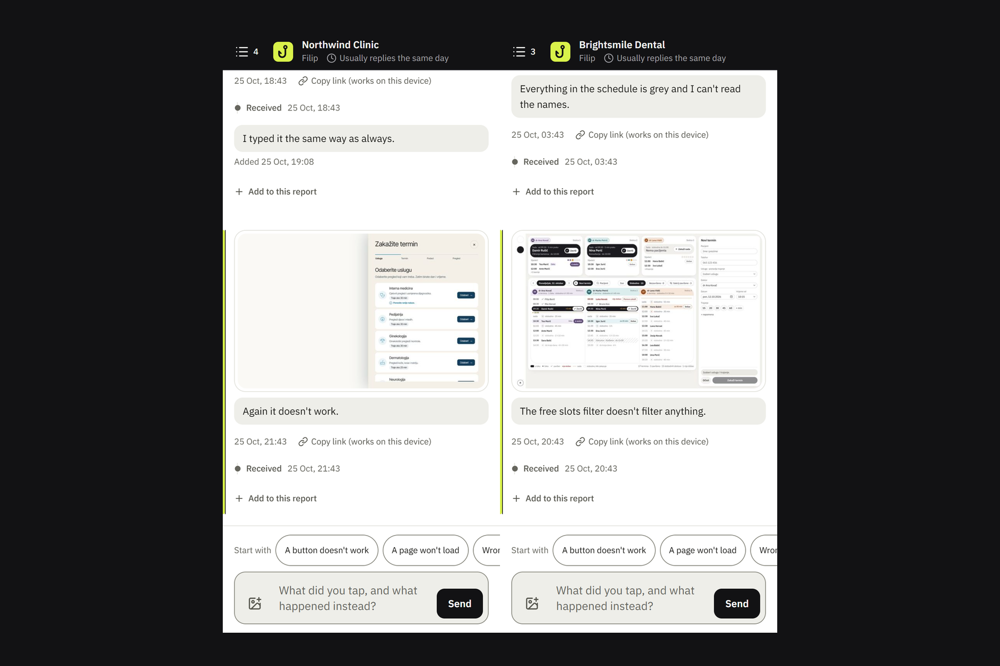

# Snag

Snag turns a client's screenshot and one sentence into a structured bug ticket.

**Live demo:** https://snag-chi.vercel.app · **Video (2 min):** https://youtu.be/1GSalfRjA2A



A client sends one screenshot and one sentence through a private link. Snag saves it first, then a vision model turns it into a structured ticket for the developer: what the screenshot shows, kept apart from what the model inferred, with an evidence line under every inference or "not enough in the screenshot to tell". The developer works the tickets in a dashboard that reads like a chat per client, edits any field in place, and copies the ticket as GitHub-flavoured Markdown.

Built for the Devpost hackathon *Build With AI: Basics* (October 2026) by a freelance developer who maintains apps for small local businesses, to replace "it doesn't work" messages on WhatsApp.

## Why I built this

_Filip: 3–4 sentences, in your own words._

## What it does

- **Client page** (`/r/<slug>`): one feed, three panes on a desktop. The client sends a screenshot and a sentence; their reports stay on their device (localStorage, one key per link) with their status (Received, In progress, Done), and they can add text to a report later. No account.
- **Extraction**: Claude reads the screenshot and the sentence and returns a ticket in a fixed shape. Observed fields (title, where, what's wrong, priority, tags) are separated from inferred ones (expected result, steps to reproduce), which carry evidence or stay empty. Low confidence or a missing "what's wrong" raises an **Ask client** flag instead of a guess.
- **Dashboard** (`/dashboard`): one access code; Inbox and Done; clients grouped by recency; each client's reports as a chat with a ticket card under every message; status tabs; j/k/Enter/c keys. A failed reading can be retried.
- **Ticket detail**: the screenshot and the verbatim sentence beside the fields. Every field saves when you leave it; a field that no longer reads as the model wrote it is marked **Edited**, with "AI wrote: …" on hover. Copy as Markdown produces a GitHub issue body.





## Built with

- **Claude Code** with the **Devpost Learn skill pack** for the whole build: scope → PRD → spec → checklist → small, test-first slices. The planning documents are in `devpost/`.
- **Claude Sonnet** for extraction, with a Zod-validated structured output.
- **Next.js 16**, TypeScript, Tailwind CSS v4, shadcn/ui.
- **PostgreSQL** with Drizzle ORM.
- **Docker Compose** locally; **Vercel** and **Supabase** (Postgres and a private storage bucket) in production.
- **Playwright** to record the demo clips; **ElevenLabs** for the video voiceover, from a script I wrote.

## How it was tested

- 407 automated tests (unit and database-backed), plus typecheck, lint and a production build, all passing.
- Every migration checked against Postgres 15 and 17 (the versions Supabase runs) as well as the local Postgres 18.
- A live run end to end: a report sent from a 390px-wide phone page was saved, extracted and shown in the open dashboard, on the Compose setup and on the Vercel deployment.
- A review pass against what hackathon judges look for (no auth wall, realistic demo data, first-seconds clarity), with every finding fixed or listed in `docs/review.md`.
- The extraction eval: see the next section for what it does and doesn't prove yet.

## Run it

Needs Docker. Copy `.env.example` to `.env`, fill in the values it asks for (an Anthropic API key with a spend limit, three distinct secrets, a Postgres password), then:

```bash
docker compose up --build -d
```

The app is at http://localhost:3000. Migrations run before the app starts. The first start creates no projects; add one from the dashboard with **New project**, or load the demo:

```bash
docker compose run --rm migrate npx tsx --conditions=react-server scripts/seed-demo.ts
```

The demo adds four fictional clients with 16 reports taken from synthetic screenshots, already extracted (the model's output is stored in `seed/demo/results.json`, so loading it spends no API credits). It includes Ask client cards, a failed reading with Retry, a follow-up message, and statuses spread across New, In progress and Done. The demo projects are flagged `demo`: their client page shows every report of the project, so the feed is never empty, and their office hours are every day, all day. A real project's page shows only the reports sent from that device, and uses the default hours (Mon–Fri 9–17).

The demo screenshots are not in the repository: like the eval images, they stay on the developer's machine. `npx tsx scripts/demo-images.ts` builds `seed/demo/images/` from the eval captures. Run the seed through Compose as above, so the screenshots land in the app container's uploads volume; a seed run on the host writes to `./.uploads`, which the container doesn't see.

To deploy on Vercel with Supabase (Postgres and screenshot storage) instead, see [docs/deploy.md](docs/deploy.md); Compose keeps working as above.

For development on the host: `npm install`, `docker compose up -d db`, `npm run db:migrate`, `npm run dev`. Tests: `npm test` (rebuilds a `snag_test` database from the migrations on every run).

## How honest the extraction is

Fields the model cannot support stay empty rather than being guessed; the eval counts any invented inferred field as a failure of the whole run. The eval set (`eval/`) is 21 synthetic screenshots from the developer's own apps with fictional data; the client sentences will be written by real non-technical people role-playing a client. So far only case 001 has its sentence and reference, so no acceptance number is published yet. `npm run eval` prints the numbers once the cases are filled in; `eval/README.md` explains the scoring and its limits.

## Limits of this proof of concept

- One developer, one access code, plus an optional second code for judges (`DEMO_ACCESS_CODE`). No accounts.
- One screenshot per report. Follow-ups are text only.
- The login, report and follow-up limits count per address and live in the database, so they hold across serverless instances. The address comes from `x-forwarded-for`, so the app must sit behind a reverse proxy that sets it (`APP_BIND=127.0.0.1` on a server). On top of that, the app starts at most 60 extractions an hour across all links.
- Real client reports may be messier than the eval set: blurry photos, the wrong screen, mixed languages.
- The model sometimes treats a user mistake as a high-priority bug. Eval case 001 (required fields left empty) and the Pinewood demo ticket about a departure date before the arrival were both rated High. The reference tickets record the correct priority; the prompt is unchanged for now.
- Times are shown in the developer's zone (Europe/Sarajevo); per-client time zones are out of scope.
- The live demo at https://snag-chi.vercel.app is shared: everyone with the judges' code sees the same demo data and the reports others send.

## Why I built this

I’m just starting out as a freelance developer, building and maintaining websites for small local businesses. When something breaks, I get “it doesn’t work” and a screenshot on WhatsApp, and the real work starts with ten questions. I wanted my clients to keep doing exactly what they already do, while I get a ticket I can act on. Snag is built for me and my own clients first, a closed setup rather than a public product.

## What's next

First, real data: fill the eval set with sentences from non-technical people role-playing clients, and publish the acceptance numbers. Then what my own clients will need: more than one screenshot per report, a way to reply to the client, and creating GitHub issues directly. Longer term, multi-user, so Snag can grow into a tool for freelancers and small software agencies.

## Where things are

| | |
| --- | --- |
| Planning docs | `devpost/` (scope, PRD, spec, build checklist) |
| Client page | `app/(client)/r/[slug]/` |
| Dashboard and ticket detail | `app/(admin)/dashboard/` |
| Extraction | `lib/extraction/` (prompt, schema, retry policy, the run) |
| Data model and migrations | `lib/db/schema.ts`, `drizzle/` |
| Eval runner and capture tooling | `eval/` |
| Demo seed | `scripts/seed-demo.ts`, `seed/demo/` |
